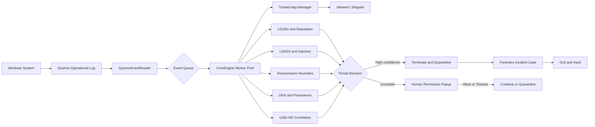
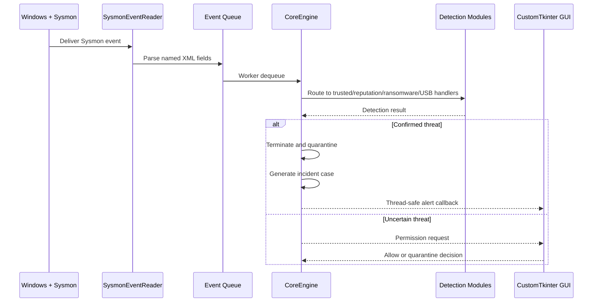
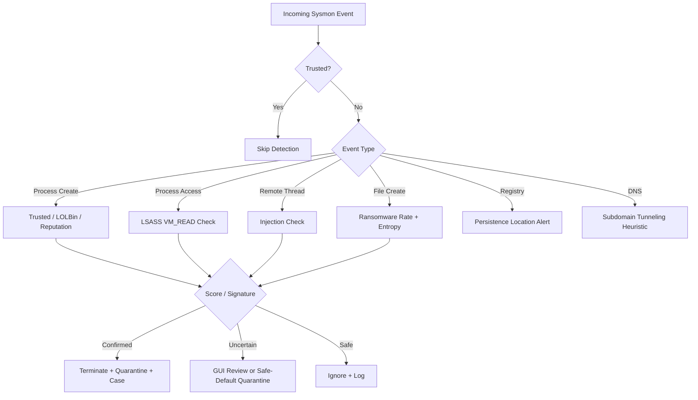

<div align="center">
  
  <h1>🛡️ Vanguard Knight</h1>
  <p><strong>The Immortal Shield Of Your System</strong></p>
  <p>Windows endpoint detection and response with real-time event analysis,<br/>local hand-biometric deactivation, BadUSB defense, deception, and SOC-style forensics.</p>

  <a href="https://github.com/uzankhan/Vanguard-Knight"></a>
  <a href="https://github.com/uzankhan/Vanguard-Knight/stargazers"></a>
  <a href="https://www.python.org/"></a>
  
  
</div>

> [!WARNING]
> Vanguard Knight is a personal security project and **not a certified or replacement-grade commercial EDR**. It uses heuristics and user-space controls. Camera-based hand geometry is a friction and anti-spoofing layer, not forensic-grade biometric authentication. Test in a VM or controlled system before live use.

## 🧭 Quick Navigation

| 🚀 Start | 📚 Learn | 🧩 Features | 🛠️ Operations | 🆘 Support |
|---|---|---|---|---|
| [Quick Start](#-quick-start) | [How It Works](#-how-it-works) | [Key Features](#-key-features) | [Windows Service](#-windows-service) | [FAQ](#-faq--troubleshooting) |
| [Prerequisites](#-prerequisites) | [Architecture](#-architecture) | [Detection Pipeline](#-detection-pipeline) | [Testing](#-testing--quality) | [Contact](#-contact--support) |

---

## 🎬 Interface Preview

<div align="center">
  
  <br/><br/>
  <b>Animated dark-tactical dashboard • Pulsing shield control • Live terminal log • Threat popups • Matrix-style HUD effects</b>
</div>

<!-- TODO: Add a 1280x720 dashboard screenshot showing ACTIVE protection state. -->
<!-- TODO: Add a 1280x720 GIF demonstrating activation, threat detection, and hand-verification deactivation. -->
<!-- TODO: Add a 1280x720 setup-wizard screenshot showing hand enrollment. -->

---

## 🎯 Why Vanguard Knight?

| Everyday risk | Vanguard Knight's response |
|---|---|
| Suspicious software launches | Sysmon events feed a real-time, multi-worker detection pipeline. |
| Credential-dumping or injection attempts | LSASS access-right checks and CreateRemoteThread monitoring can trigger immediate incidents. |
| Ransomware-like file bursts | File-write rates are combined with Shannon entropy analysis before confirmed or uncertain response decisions. |
| Rubber Ducky / BadUSB-style devices | Unknown HID arrivals can be correlated with rapid shell launches and uniform typing cadence. |
| Unauthorized protection shutdown | Dashboard deactivation requires live hand verification or a recovery key. |
| Investigation after an alert | Incident folders contain JSON, Markdown reports, process details, hashes, network connections, and quarantine references. |

---

## ✨ Key Features

| Area | Capability |
|---|---|
| 🛰️ **Real-time telemetry** | Uses the Windows Sysmon operational event channel with named XML field parsing and a persistent bookmark. |
| 🧠 **Detection routing** | Routes process creation, process access, remote-thread, file creation, registry, and DNS events through dedicated handlers. |
| 🛡️ **Trusted applications** | User-approved executable paths bypass detection for normal process launches. |
| 🧬 **Ransomware heuristics** | Tracks file-write rates per PID and analyzes file entropy to distinguish strong combinations from weak signals. |
| 🔑 **Credential-theft detection** | Flags suspicious `PROCESS_VM_READ` access to LSASS while excluding core Windows processes and trusted applications. |
| 🧷 **Process-injection detection** | Watches Sysmon Event ID 8 for CreateRemoteThread activity. |
| 💾 **Quarantine** | Copies and removes detected executables under `C:\VanguardKnight_Vault\Quarantine`. |
| 🔎 **SOC-style forensics** | Creates per-incident JSON and Markdown reports and retains a lightweight incident index for 7 days of evidence cleanup. |
| 🎭 **Honeypot deception** | Deploys tempting decoy files for maximum-confidence access alerts. |
| ⌨️ **BadUSB defense** | Performs machine-speed typing-cadence checks and unknown HID-to-shell launch correlation. |
| 🖐️ **Hand verification** | MediaPipe hand-gesture and geometry matching protects deactivation. |
| 🖥️ **Animated dashboard** | CustomTkinter interface with pulsing controls, HUD panels, matrix-style background, alert popups, and live logs. |
| ⚙️ **Windows service mode** | Installs as an auto-start service with SCM crash recovery and periodic self-integrity monitoring. |

---

## 🧱 How It Works



`app_main.py` selects first-run setup or the dashboard. `VanguardMainWindow` creates `CoreEngine`, while `SysmonEventReader` subscribes to Sysmon events and pushes parsed dictionaries into a queue. Four worker threads route events through `core_engine.py`, which applies allowlists, reputation scoring, malware heuristics, and USB correlation. Confirmed detections terminate and quarantine the executable, then create JSON/Markdown evidence through `ForensicsManager`. Uncertain detections are sent to a GUI decision popup or fail safe to quarantine in headless service mode.

---

## 🚀 Quick Start

### Prerequisites

- Windows 10 or Windows 11, 64-bit
- Python **3.8+**; Python 3.11 is recommended in the repository guide
- Administrator privileges
- At least **5 GB** free disk space
- A webcam for hand verification
- Microsoft Sysmon for real telemetry

### Step 1 — Clone and enter the repository

```bash
git clone https://github.com/uzankhan/Vanguard-Knight.git
cd Vanguard-Knight
```

### Step 2 — Create an environment and install dependencies

```powershell
py -3.11 -m venv .venv
.\.venv\Scripts\Activate.ps1
python -m pip install --upgrade pip
python -m pip install psutil wmi pywin32 customtkinter pillow opencv-python mediapipe numpy scikit-learn scapy colorama cryptography pyyaml joblib pyusb pystray
```

> [!NOTE]
> The repository does not include a pinned `requirements.txt`. The command above includes dependencies named by its source files and guides. Install only what you need for your deployment.

### Step 3 — Install Sysmon

```powershell
Sysmon64.exe -accepteula -i sysmon_config.xml
```

Run this from an elevated PowerShell or Command Prompt. The exact Sysmon executable name and download location must match the Microsoft Sysinternals package installed on the machine.

### Step 4 — Launch Vanguard Knight

```powershell
python app_main.py
```

On first launch, the setup wizard asks for the Vault location, enrolls your hand gesture, and generates a recovery key.

### Step 5 — Verify it works

Run as Administrator, open the dashboard, and select **ACTIVATE**. A healthy startup displays Sysmon subscription status and engine worker messages in the live activity log. The application also logs:

```text
[+] Vanguard Knight Core Engine started.
[+] 4 worker thread(s) running.
[+] ... trusted app(s) loaded.
[SYSMON] Subscribed successfully (callback mode) -- real-time monitoring is now genuinely active.
```

For visual-only testing without Windows engine dependencies:

```powershell
python gui_app.py
```

This opens the dashboard and displays a sample threat popup after a short delay.

---

## 🏗️ Architecture



### Main modules

| Module | Responsibility |
|---|---|
| `app_main.py` | Production entry point; setup check and dashboard launch. |
| `gui_app.py` | CustomTkinter dashboard, alerts, system tray, animation, and engine callbacks. |
| `wizard.py` | First-run Vault, hand enrollment, and recovery-key setup. |
| `core_engine.py` | Event routing, detection, response, worker threads, quarantine, and incident creation. |
| `sysmon_reader.py` | Persistent, push-based Sysmon event subscription and XML parsing. |
| `hand_auth.py` | MediaPipe gesture enrollment and verification. |
| `usb_guard.py` | HID arrival tracking and inhuman typing-cadence analysis. |
| `deception.py` | Honeyfile deployment and access-trigger alerts. |
| `forensics.py` | Incident JSON/Markdown reports and evidence cleanup. |
| `windows_service.py` | Windows SCM service wrapper and auto-recovery configuration. |
| `watchdog_main.py` | Companion watchdog behavior. |
| `system_hardening.py` | Security posture checks and 24-hour hardening scans. |
| `recovery_key.py` | Recovery-key generation, storage, and validation. |
| `theme.py` | Product colors, fonts, logo, window icon, and UI constants. |

---

## 🔍 Detection Pipeline



### Detection tiers

| Tier | Condition | Action |
|---|---|---|
| **Safe** | Reputation score is 45 or higher after normal process checks | Continue without blocking. |
| **Review** | Reputation score is 25–44, or rate/weak correlation needs human context | Ask the GUI user; service mode quarantines by default. |
| **Confirmed** | LOLBin pattern, dangerous LSASS access, injection, combined ransomware signals, or a strong honeytoken signal | Terminate/quarantine and create a forensics case. |

> [!CAUTION]
> Detection behavior must be validated against your own software and workload. False positives can affect processes or files. The engine is designed with trusted-app and protected-system-process safeguards, but it is not risk-free.

---

## ⚙️ Configuration

Vanguard Knight currently uses Python constants and OS paths rather than a `.env` file.

| Setting | Default / Location | Defined in |
|---|---|---|
| Vault | `C:\VanguardKnight_Vault` | `core_engine.py`, `wizard.py`, `sysmon_reader.py` |
| Quarantine | `C:\VanguardKnight_Vault\Quarantine` | `core_engine.py` |
| Forensics | `C:\VanguardKnight_Vault\Forensics` | `forensics.py` |
| Forensics retention | 7 days | `forensics.py` |
| Hand profile | `C:\VanguardKnight_Vault\hand_auth_profile.json` | `hand_auth.py` |
| Recovery key | `C:\VanguardKnight_Vault\recovery_key.enc` | `recovery_key.py` |
| Sysmon channel | `Microsoft-Windows-Sysmon/Operational` | `sysmon_reader.py` |
| Sysmon bookmark | `C:\VanguardKnight_Vault\sysmon_bookmark.json` | `sysmon_reader.py` |
| Worker threads | 4 | `core_engine.py` |
| Event queue size | 5000 | `core_engine.py` |

There is currently **no `.env.example`** or environment-variable configuration file.

---

## 🖥️ Windows Service

Install the core engine as an auto-start Windows service with an elevated terminal:

```powershell
python windows_service.py install
python windows_service.py start
```

Useful commands:

```powershell
python windows_service.py debug
python windows_service.py stop
python windows_service.py remove
```

The service:

- starts the `CoreEngine` automatically;
- uses fail-safe quarantine for uncertain detections because no GUI is attached;
- maintains a heartbeat in `C:\VanguardKnight_Vault`;
- checks integrity for selected core files every 60 seconds;
- configures SCM recovery actions to restart after crash or stop.

Run service operations from an Administrator terminal.

---

## 🧪 Testing & Quality

No conventional pytest suite or CI workflow is currently present. Several modules include runnable self-tests behind `if __name__ == "__main__"`:

```powershell
python core_engine.py
python sysmon_reader.py
python hand_auth.py
python usb_guard.py
python forensics.py
python deception.py
python entropy.py
```

The `core_engine.py` dry run uses simulated events and mocked internals. Its tests cover LOLBins, signed processes, LSASS access, and trusted applications. The hand-auth module includes synthetic same-person and different-person landmarks, while the USB guard test includes human and uniform machine-speed typing patterns.

Because this project modifies processes and files when active, always test destructive paths in a VM or isolated Windows environment first.

---

## 📁 Project Structure

```text
Vanguard-Knight/
├── app_main.py                 # Production entry point
├── gui_app.py                  # Dashboard and animated interface
├── wizard.py                   # First-run setup flow
├── core_engine.py              # Detection and response pipeline
├── sysmon_reader.py            # Sysmon subscription and XML parser
├── hand_auth.py                # Hand enrollment and verification
├── hand_verify_dialog.py       # Deactivation verification dialog
├── recovery_key.py             # Recovery-key generation and fallback
├── usb_guard.py                # BadUSB/HID detection
├── deception.py                # Honeypot and honeytoken logic
├── forensics.py                # Incident reports and evidence retention
├── entropy.py                  # File entropy analysis
├── trusted_apps.py             # Executable allowlist
├── system_hardening.py         # Posture scan and remediation
├── network_recon.py            # Network reconnaissance helpers
├── persistence_guard.py        # Persistence protections
├── self_protection.py          # Integrity, heartbeat, and watchdog helpers
├── watchdog_main.py            # Companion watchdog process
├── windows_service.py          # Windows service wrapper
├── sysmon_config.xml           # Sysmon event configuration
├── theme.py                   # Visual theme and icon/logo helpers
├── hacker_fx.py               # Matrix, glitch, HUD, and typewriter effects
├── verdict_popup.py           # Uncertain-threat decision popup
├── logo.png                   # Application logo
├── logo.ico                   # Windows application icon
├── Eula.txt                   # End-user license agreement text
└── Requirments-Command.txt    # Setup and command reference
```

---

## ❓ FAQ & Troubleshooting

<details>
<summary><b>Sysmon subscription fails with “ACCESS DENIED”</b></summary>

Close the application and launch it from an elevated terminal using “Run as Administrator.” Sysmon event-log access commonly requires administrative privileges.

</details>

<details>
<summary><b>The Sysmon channel is not found</b></summary>

Install and start Sysmon, then apply the repository configuration:

```powershell
Sysmon64.exe -accepteula -i sysmon_config.xml
```

</details>

<details>
<summary><b>MediaPipe or OpenCV says it is missing</b></summary>

Install the webcam dependencies into the active environment:

```powershell
python -m pip install opencv-python mediapipe
```

The app can run its dashboard on some non-Windows systems, but Windows-only monitoring requires a Windows host and the associated packages.

</details>

<details>
<summary><b>Hand verification is unavailable</b></summary>

Use the recovery-key fallback shown during first-run setup. Keep the recovery key in a secure password manager or offline location.

</details>

<details>
<summary><b>The dashboard starts but no events appear</b></summary>

Confirm that:

1. the app is running as Administrator;
2. Sysmon is installed and listening on `Microsoft-Windows-Sysmon/Operational`;
3. `pywin32` is installed;
4. the live log shows a successful subscription message.

</details>

<details>
<summary><b>Legitimate software was flagged</b></summary>

Stop live blocking where possible and validate the detection reason. Add trusted applications through the repository's `TrustedAppManager` workflow rather than disabling the entire engine.

</details>

<details>
<summary><b>How do I inspect evidence?</b></summary>

Open `C:\VanguardKnight_Vault\Forensics\<case-id>\`. Each active case contains `case_summary.json` and `case_report.md`. The permanent lightweight incident index is `_incident_index.json`.

</details>

---

## 🗺️ Roadmap

- Add a canonical pinned `requirements.txt` or `pyproject.toml`.
- Add a standard pytest suite and GitHub Actions workflow.
- Add an end-to-end Windows installer and uninstaller.
- Add real low-level keyboard/HID device hooks to the USB cadence implementation.
- Add registry and SACL setup for active registry honeytokens.
- Add screenshot, demo GIF, and architecture documentation assets.
- Expand automated tests for the full detection pipeline.

---

## 🤝 Contributing

Contributions are welcome for Windows security research, detection quality, test coverage, UI/UX, documentation, and safe default behavior.

1. Fork the repository.
2. Create a descriptive branch.
3. Make the smallest focused change.
4. Run the relevant embedded module self-tests.
5. Open a pull request with test environment and expected behavior.

Please do not submit secrets, surveillance hooks, bypass-only payloads, or real credential samples. Never weaken safety checks to make a demo faster.

---

## 📚 Documentation

- [`Requirments-Command.txt`](Requirments-Command.txt) — requirements and command guide
- [`Eula.txt`](Eula.txt) — end-user license agreement text
- [`sysmon_config.xml`](sysmon_config.xml) — Sysmon monitoring configuration
- [`logo.png`](logo.png) — project logo
- [`logo.ico`](logo.ico) — Windows icon

> [!NOTE]
> No formal license file was found in the repository. The EULA text is not a substitute for an OSI-style source-code license until a license is explicitly added and referenced.

---

## 📬 Contact & Support

- **Author:** Uzan Khan
- **Email:** [uzankhan17@gmail.com](mailto:uzankhan17@gmail.com)
- **Repository:** [uzankhan/Vanguard-Knight](https://github.com/uzankhan/Vanguard-Knight)
- **Issues:** [Open an issue](https://github.com/uzankhan/Vanguard-Knight/issues)

## © License

No standalone `LICENSE` file or license metadata was detected. Legal reuse, copying, and distribution terms should be clarified before external use. The existing [`Eula.txt`](Eula.txt) is available, but it should not be interpreted automatically as a repository source license.

<div align="center">

**Vanguard Knight — The Immortal Shield Of Your System**

[](#-vanguard-knight)

</div>
